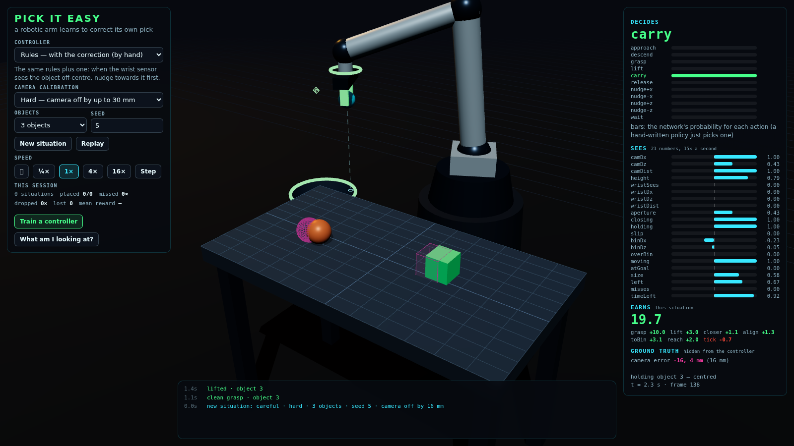

# Pick It Easy

https://mochiyaki.github.io/app10/

A 3D robotic-arm pick-and-place simulator in the browser (three.js, no build step), and a lesson in **training a
small model to correct the pick when the camera is wrong** — for AI/ML students and researchers who want to see every
number of the training loop, not a library call.

The arm picks objects off a table and drops them in a bin. It has two senses: a **camera over the table** whose
calibration is off (every estimate is shifted by the same unknown few millimetres), and a **short-range sensor in the
wrist** that sees the true offset of an object right under the fingers. The classic open-loop pick — *camera says
there, go there, close* — fails as soon as the calibration drifts: the fingers close on air, pinch an edge and drop the
object, or knock it off the table. The correction is closed-loop: read the wrist sensor, nudge over, *then* descend.
You can write that rule by hand in one line. The point of this project is a **network that finds it on its own** — imitation, evolution and reinforcement — in plain JavaScript, with the same tiny MLP, in seconds to minutes on a laptop.



This project uses NVIDIA Nemotron 3.5 Super VL as a **teacher** for a two-joint simulated arm. It collects the teacher's joint commands and fits a tiny local linear policy by imitation learning. It does not fine-tune the 120B-parameter Nemotron model.

## Run

Python 3.10 or newer is recommended.

```powershell
python -m venv .venv
.venv\Scripts\Activate.ps1
pip install -r requirements.txt
```

First run the entire pipeline offline:

```powershell
python train.py --mock
```

To call Nemotron through Crusoe, create an **Intelligence API key** in the
Crusoe Cloud console and set it in the environment. Point `CRUSOE_BASE_URL` at
the OpenAI-compatible URL for your Crusoe-hosted Super VL deployment:

```powershell
$env:CRUSOE_API_KEY = "your-key"
$env:CRUSOE_BASE_URL = "https://your-deployment.example/v1"
python train.py
```

The default run makes at most 36 API calls (6 episodes x 6 steps) and writes
the learned weights to `policy.npz`. Use fewer calls for a quick smoke test:

```powershell
python train.py --episodes 1 --steps 2
```

As of October 17, 2026, Crusoe's documented shared serverless catalog includes
Nemotron 3.5 Lightning but does not list the newly released Super VL. Use a
Crusoe self-serve/NIM deployment for the exact model until it appears in the
shared catalog. Confirm the models exposed by whichever endpoint you use:

```powershell
$headers = @{ Authorization = "Bearer $env:CRUSOE_API_KEY" }
(Invoke-RestMethod "$env:CRUSOE_BASE_URL/models" -Headers $headers).data.id
```

If the ID differs, pass it with `--model MODEL_ID` or set `CRUSOE_MODEL`.

## What the pipeline does

1. Randomizes the arm and a reachable target.
2. Sends the joint angles, end-effector position, and target to Nemotron.
3. Applies and records Nemotron's two joint-angle deltas.
4. Fits a seven-input, two-output linear policy with least squares. The inputs
   include simple sine/cosine geometry features for the two-link arm.
5. Evaluates the learned policy on fresh targets and saves it.

This is intentionally small and educational. A real robotics pipeline would
add collision checks, actuator limits, image observations, a stronger policy,
many more trajectories, and hardware safety controls.

## Train

```sh
npm run train:clone                                   # lesson 1: copy the open-loop rules       (≈ 1 s)   → bots/clone.json
npm run train:reinforce -- --from bots/clone.json     # lesson 3: improve them by reward          (≈ 45 s)  → bots/reinforce.json
npm run train:evolve                                  # lesson 2: evolve from scratch, on normal  (≈ 3 min) → bots/evolve.json
npm run play -- --bot bots/reinforce.json             # score it against the rules on the same situations
npm run bench -- --bot bots/reinforce.json --diff hard   # a whole shift: 20 situations, the totals
```

Then watch it: `?bot=bots/reinforce.json`. [train/README.md](train/README.md) explains every step, with the numbers.

## The lesson in one table

Eight fresh situations on *hard* (1–3 objects, camera off by up to 30 mm), 30 s each. Reward per situation; placed
= objects dropped in the bin.

| Controller | Trained in | Reward | Placed | Missed grasps | Per situation | A shift on hard (60 objects) | …on normal |
|---|---|---|---|---|---|---|---|
| open-loop rules (`scripted.js`) | — | 38.4 | 8 / 16 | 9× | 8.0 s | 70 % placed, 9.5 picks/min | 97 %, 22.6/min |
| rules + correction by hand (`careful`, `bots/example.js`) | — | 111.5 | 16 / 16 | 0× | 5.5 s | 100 %, 19.7/min | 100 %, 19.8/min |
| lesson 1: imitation of the rules (`clone.json`) | 1 s | 42.4 | 8 / 16 | 5× | 11.3 s | 65 %, 7.1/min | 90 %, 22.3/min |
| lesson 1b: imitation of the careful rules (`clone-careful.json`) | 1 s | 111.4 | 16 / 16 | 0× | 5.3 s | 100 %, 20.3/min | 100 %, 20.5/min |
| lesson 3: reinforcement from the clone (`reinforce.json`) | 45 s | 101.0 | 15 / 16 | 0× | **3.5 s** | 98 %, **29.2/min** | 98 %, 30.5/min |
| lesson 2: evolution from scratch (`evolve.json`, trained on *normal*) | 2 min | 25.1 | 5 / 16 | 4× | 18.6 s | 45 %, 4.0/min | 85 %, 11.6/min |

(`npm run play -- --bot <spec> --seed 1001` and `npm run bench -- --bot <spec> --diff hard` reproduce the columns.)

Imitation copies the rules, blindness included — it never nudges, because the teacher never did (shown a teacher
that corrects, it corrects: lesson 1b). Reinforcement started from the imitation begins as the rules and, a few
thousand episodes later, **nudges** (an action it had never seen) whenever the wrist sensor shows an offset — and it
is half again as fast as the hand-written correction, because nobody told it to be careful, only to be paid.
Evolution from random weights finds the whole pick sequence with no teacher at all, but only where the first grasp
pays often enough to be selected for (on *normal*); on *hard* the reward is too sparse to find by chance, and what
it learned on normal only half transfers. That is the whole curriculum of modern
agent training in three scripts: pre-train by imitation, fine-tune by reward, and shape the reward or the
difficulty when it is too sparse.

## The pieces

| File | What it is |
|---|---|
| `src/sim/arm.js` | The arm: 4 joints + gripper, closed-form inverse kinematics, a speed profile. Pure maths. |
| `src/sim/world.js` | The cell: table, bin, objects, the grasp / slip / miss / bump physics, the two senses, the difficulties. |
| `src/bot/env.js` | The environment: `FEATURES` (what a controller sees), `ACTIONS` (what it can do), `sense` / `observe` / `act`. |
| `src/bot/scripted.js` | The hand-written rules as a policy — the baseline and the teacher; `careful` adds the correction. |
| `src/bot/nn.js` | The tiny neural network (shared with the game): forward, backprop, mutation, save / load. |
| `src/bot/bots.js` | Loading a controller: the rules, a `bots/*.json` network, or your own `bots/*.js` module. |
| `src/view/` | The three.js scene, an orbit camera, the HUD. Reads the sim, never writes it. |
| `src/main.js` | The viewer: the loop, the controls, the Train drawer. |
| `train/core.js` | The reward, an episode, situations, scoring, and the three lessons (Node and browser). |
| `train/clone.mjs` · `evolve.mjs` · `reinforce.mjs` · `play.mjs` | The lessons and the scorer on the command line. |
| `train/worker.js` | The lessons in a Web Worker (the Train drawer). |
| `bench/run.mjs` · `bench/trace.mjs` | A whole shift with any controller; one episode decision by decision in the terminal. |
| `bots/` | Trained networks and hand-written modules (`example.js`). |

## The physics, in five lines

A parallel gripper forgives an error **along** its closing axis (the pads push the object to the middle) but not
**across** it: within half the object's width the grasp is clean; further off the pads pinch an edge and the object
slips out about a second later; further still they pass the object and close on air. A finger coming down on top of an
object shoves it out of the way — sometimes off the table. Released over the bin, the object is placed; over the
table, dropped; anywhere else, lost. Everything is deterministic from a seed: the same seed is the same situation.

## Things to try

- **Blind the correction.** Delete `wristDx` / `wristDz` from `FEATURES` and retrain lesson 3: can it still learn from
  `wristDist` alone? (It can see *how far*, not *which way*.)
- **Make the camera drift.** *Extremely hard* turns the bias slowly: the correction must be redone on every object.
  Which controllers survive?
- **Change the reward.** Set `miss` to 0: does the clone-then-reinforce controller stop caring? Set `tick` to −0.2:
  does it hurry? Watch the "per situation" column.
- **A curriculum.** `npm run train:evolve` on *normal*, then `-- --from bots/evolve.json --diff hard --sigma 0.05`. In
  our run it did not improve on hard in 100 generations — what would make it?
- **Beat the rules by hand.** Edit `bots/example.js` until it places faster than `reinforce.json`.
- **A new action.** Add `'peek'` to `ACTIONS` — descend to the sensor's height, no further — and see who uses it.

Pick It Easy is under MIT licence.
